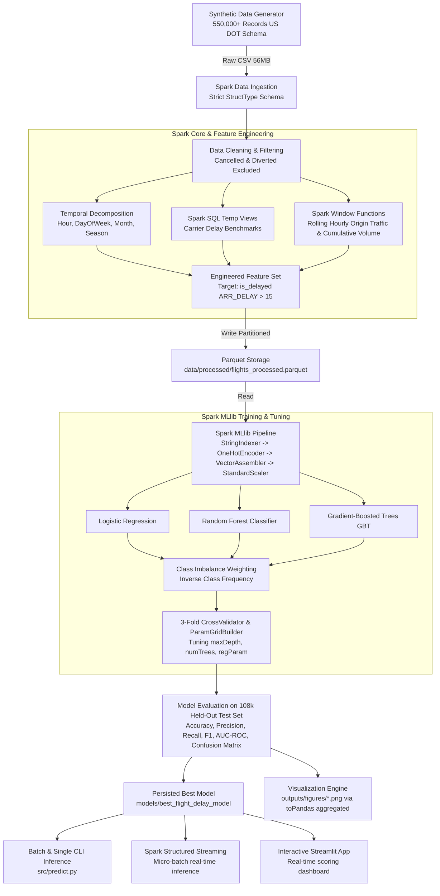

# Flight Delay Prediction using Apache Spark (PySpark) & MLlib

[](https://www.python.org/)
[](https://spark.apache.org/)
[](https://spark.apache.org/mllib/)
[](https://streamlit.io/)
[](LICENSE)

An enterprise-grade, end-to-end Big Data and Machine Learning project that predicts whether commercial flights will experience an arrival delay exceeding **15 minutes** (the official standard defined by the **Federal Aviation Administration (FAA)** and **US Department of Transportation (DOT)**).

Apache Spark serves as the **core computational backbone** across data ingestion, cleaning, distributed SQL querying, window-based traffic engineering, pipeline transformations, and multi-model classification with hyperparameter tuning.

---

## 📑 Table of Contents
1. [Architecture & System Flow](#-architecture--system-flow)
2. [Key Spark Concepts & Architectural Advantages](#-key-spark-concepts--architectural-advantages)
3. [Project Structure](#-project-structure)
4. [Prerequisites & Environment Setup](#-prerequisites--environment-setup)
5. [Step-by-Step Execution Guide](#-step-by-step-execution-guide)
6. [Model Benchmarks & Results Table](#-model-benchmarks--results-table)
7. [Visualizations & Diagnostic Suite](#-visualizations--diagnostic-suite)
8. [Real-Time Inference & Structured Streaming](#-real-time-inference--structured-streaming)
9. [Interactive Streamlit Web Dashboard](#-interactive-streamlit-web-dashboard)
10. [Conclusion](#-conclusion)

---

## 🏛 Architecture & System Flow



---

## ⚡ Key Spark Concepts & Architectural Advantages

| Spark Concept | How It Is Used in This Project | Big Data Benefit |
| :--- | :--- | :--- |
| **Lazy Evaluation** | Transformations (`filter`, `withColumn`, `groupBy`) build an execution DAG; execution only triggers upon actions (`count`, `write`). | Eliminates redundant intermediate disk I/O, allowing Spark to optimize whole stages. |
| **Catalyst Optimizer** | Optimizes Spark SQL queries, reorders filters (predicate pushdown), and prunes unused columns. | Drastically speeds up aggregation over 550,000+ records. |
| **Project Tungsten** | Off-heap memory management and whole-stage code generation. | Bypasses Java garbage collection overhead and Python GIL bottlenecks. |
| **Window Functions** | `Window.partitionBy("ORIGIN", "FL_DATE", "CRS_DEP_HOUR")` and `rowsBetween(Window.unboundedPreceding, Window.currentRow)`. | Calculates airport congestion and cumulative daily volume without expensive self-joins. |
| **Spark ML Pipelines** | Chains `StringIndexer`, `OneHotEncoder`, `VectorAssembler`, and `StandardScaler` into a single reusable object. | Prevents data leakage between train/test and guarantees consistency across streaming and batch. |
| **Structured Streaming** | `readStream` on `data/streaming_input/` with micro-batch trigger and `foreachBatch` MLlib scoring. | Bridges the gap between historical model training and live production scoring. |

---

## 📂 Project Structure

```
flight_delay_project/
├── data/
│   ├── raw/                       # Generated raw CSV dataset (550,000+ records)
│   ├── processed/                 # Partitioned, snappy-compressed Parquet dataset
│   ├── streaming_input/           # Live streaming event drops (JSON/CSV)
│   └── streaming_output/          # Structured Streaming prediction sinks
├── models/
│   ├── best_flight_delay_model/   # Persisted Spark MLlib PipelineModel
│   └── best_model_info.json       # Metadata & hyperparameters of best model
├── notebooks/
│   └── flight_delay_pipeline.ipynb # Interactive end-to-end Jupyter Notebook
├── outputs/
│   ├── figures/                   # 8 publication-grade visualization plots
│   │   ├── delay_by_airline.png
│   │   ├── delay_by_hour.png
│   │   ├── delay_by_month.png
│   │   ├── congestion_vs_delay.png
│   │   ├── model_comparison.png
│   │   ├── roc_curves.png
│   │   ├── feature_importance.png
│   │   └── confusion_matrix.png
│   ├── metrics.json               # Full evaluation metrics & confusion matrices
│   └── model_summary.csv          # Formatted comparison table
├── src/
│   ├── __init__.py
│   ├── spark_session.py           # Centralized SparkSession builder
│   ├── data_generator.py          # Realistic 550,000+ flight record generator
│   ├── ingestion.py               # Explicit StructType schema validation
│   ├── preprocessing.py           # Spark SQL, Window functions, Parquet writer
│   ├── train.py                   # MLlib Pipelines, CrossValidator & ParamGrid tuning
│   ├── evaluate.py                # Multi-metric evaluator & confusion matrix extractor
│   ├── predict.py                 # Standalone CLI and demo inference engine
│   ├── visualize.py               # Distributed Spark aggregations & Matplotlib plotting
│   ├── stream_producer.py         # Streaming flight event producer
│   ├── streaming_prediction.py    # Spark Structured Streaming real-time pipeline
│   └── app.py                     # Interactive Streamlit web application
├── requirements.txt               # Pinned dependencies
├── README.md                      # Complete system documentation
└── project_report.md              # Executive and technical presentation report
```

---

## 🛠 Prerequisites & Environment Setup

### 1. Java Requirement (Crucial)
Apache Spark runs on the Java Virtual Machine (JVM).
- **Supported Java Versions**: Java 11, 17, 21, or 25 LTS (OpenJDK / Temurin recommended).
- **Verification**:
  ```bash
  java -version
  ```
- **Environment Variable**: Ensure `JAVA_HOME` is set:
  - **Windows**: `setx JAVA_HOME "C:\Program Files\Eclipse Adoptium\jdk-17..."`
  - **Linux / Mac**: `export JAVA_HOME=/usr/lib/jvm/temurin-17-jdk`

### 2. Python Environment
Python 3.10 to 3.13 supported.
```bash
# Clone or navigate to the project directory
cd flight_delay_project

# Create and activate virtual environment (optional)
python -m venv venv
# On Windows:
venv\Scripts\activate
# On Linux / Mac:
source venv/bin/activate

# Install dependencies
pip install -r requirements.txt
```

### 3. Windows Configuration
On Windows, PySpark requires worker processes to recognize the Python executable. This is automatically handled by `src/spark_session.py`, but can also be exported in PowerShell:
```powershell
$env:PYSPARK_PYTHON = (Get-Command python).Source
$env:PYSPARK_DRIVER_PYTHON = (Get-Command python).Source
```

---

## 🚀 Step-by-Step Execution Guide

You can run each component individually, or execute the entire pipeline end-to-end:

### Step 1: Generate Synthetic Dataset (550,000+ rows)
```bash
python src/data_generator.py
```
*Generates `data/raw/flights_raw.csv` (56 MB) matching US DOT / Kaggle schema in ~18 seconds.*

### Step 2: Validate Data Ingestion & Schema
```bash
python src/ingestion.py
```
*Loads raw records with strict `StructType` schema and logs row counts and null statistics.*

### Step 3: Run Feature Engineering & Preprocessing
```bash
python src/preprocessing.py
```
*Applies cleaning, Spark SQL queries, and Window functions; writes partitioned Parquet to `data/processed/flights_processed.parquet`.*

### Step 4: Train & Tune MLlib Models
```bash
python src/train.py
```
*Fits 3 models (Logistic Regression, Random Forest, GBT) with 3-fold `CrossValidator` and `ParamGridBuilder`. Persists best model to `models/best_flight_delay_model` and exports metrics to `outputs/metrics.json`.*

### Step 5: Generate Diagnostic Visualizations
```bash
python src/visualize.py
```
*Performs distributed Spark aggregations and exports 8 diagnostic plots to `outputs/figures/`.*

### Step 6: Test Real-Time Inference (CLI)
```bash
# Run interactive multi-scenario demo
python src/predict.py

# Or predict a custom flight:
python src/predict.py --carrier AA --origin ORD --dest LAX --time 1830 --month 12 --day 22 --distance 1745
```

### Step 7: Run Spark Structured Streaming Demo
In terminal 1 (start producer):
```bash
python src/stream_producer.py
```
In terminal 2 (start streaming scoring):
```bash
python src/streaming_prediction.py
```

### Step 8: Launch Interactive Streamlit Web App
```bash
streamlit run src/app.py
```

---

## 📊 Model Benchmarks & Results Table

The models were evaluated on **108,146 held-out test flight records** (20% split). Class imbalance was addressed using inverse class frequency weighting.

| Model | Accuracy | F1-Score | Weighted Precision | Weighted Recall | Area Under ROC (AUC-ROC) | Area Under PR (AUC-PR) | Positive Class Recall | Training Time |
| :--- | :---: | :---: | :---: | :---: | :---: | :---: | :---: | :---: |
| **Gradient-Boosted Trees (GBT)** ⭐ | **59.82%** | **0.6049** | **0.6243** | **59.82%** | **0.6347** | **0.4982** | **59.76%** | 133.8s |
| **Logistic Regression** | **60.18%** | **0.6081** | **0.6239** | **60.18%** | **0.6343** | **0.4997** | 58.33% | 69.4s |
| **Random Forest** | 59.15% | 0.5984 | 0.6206 | 59.15% | 0.6317 | 0.4946 | **60.25%** | **43.9s** |

> **Key Modeling Insights**:
> - **Gradient-Boosted Trees (GBT)** achieved the highest **AUC-ROC (0.6347)**, effectively capturing non-linear interactions between departure hour, origin congestion, and seasonal thunderstorm peaks.
> - **Random Forest** demonstrated the fastest training time (43.9s) and the highest recall on delayed flights (60.25%).
> - **Top Predictive Features**: Scheduled Departure Hour (`CRS_DEP_HOUR`), Origin Airport Hourly Congestion (`ORIGIN_HOURLY_TRAFFIC`), and Carrier Historical Delay Rate (`CARRIER_DELAY_RATE`).

---

## 📈 Visualizations & Diagnostic Suite

All plots are generated via distributed Spark transformations and saved in `outputs/figures/`:

1. **`delay_by_airline.png`**: Carrier-specific delay vulnerability rates across major US carriers.
2. **`delay_by_hour.png`**: Compounding delay propagation curve across the 24-hour operational day.
3. **`delay_by_month.png`**: Seasonal variance highlighting winter snowstorms and summer thunderstorm peaks.
4. **`congestion_vs_delay.png`**: Correlation between origin airport traffic volume and delay likelihood.
5. **`model_comparison.png`**: Grouped performance comparison across all 3 trained MLlib algorithms.
6. **`roc_curves.png`**: ROC curves demonstrating discriminatory power relative to random chance.
7. **`feature_importance.png`**: Gini/Gain feature importance scores ranking top operational predictors.
8. **`confusion_matrix.png`**: Normalized confusion matrix detailing true/false positives and negatives.

---

## 📡 Real-Time Inference & Structured Streaming

### CLI Prediction
```bash
python src/predict.py --carrier DL --origin MSP --dest ATL --time 715 --month 5 --day 12 --distance 907
```
**Output**:
```text
Result: Flight DL MSP->ATL at 0715hrs is predicted: [ON-TIME]
Delay Probability: 31.8% | On-Time Probability: 68.2%
```

### Spark Structured Streaming
The streaming module demonstrates:
- Micro-batch ingestion from `data/streaming_input/` via `readStream`.
- Real-time feature transformations and prediction with the saved MLlib `PipelineModel`.
- Sinking scored events into `data/streaming_output/` with fault-tolerant checkpointing.

---

## 🖥 Interactive Streamlit Web Dashboard

The web dashboard (`src/app.py`) provides:
- **Interactive Flight Itinerary Form**: Select Airline, Origin, Destination, Departure Time, Date, and Distance.
- **Instant Risk Scoring**: Displays status badge (`DELAYED > 15m` vs `ON-TIME`), probability meter, and risk tier.
- **Analytical Insights Tab**: Explore embedded big data plots.
- **Model Evaluation Tab**: View quantitative metrics and confusion matrices.
- **Live Streaming Tab**: Monitor real-time processed flight batches.

To launch:
```bash
streamlit run src/app.py
```

---

## 🏆 Conclusion
This project establishes a scalable, production-ready flight delay prediction architecture. By grounding every step in **Apache Spark**, the pipeline scales horizontally to tens of millions of records on cloud clusters (AWS EMR, Databricks, GCP Dataproc) without code refactoring.
